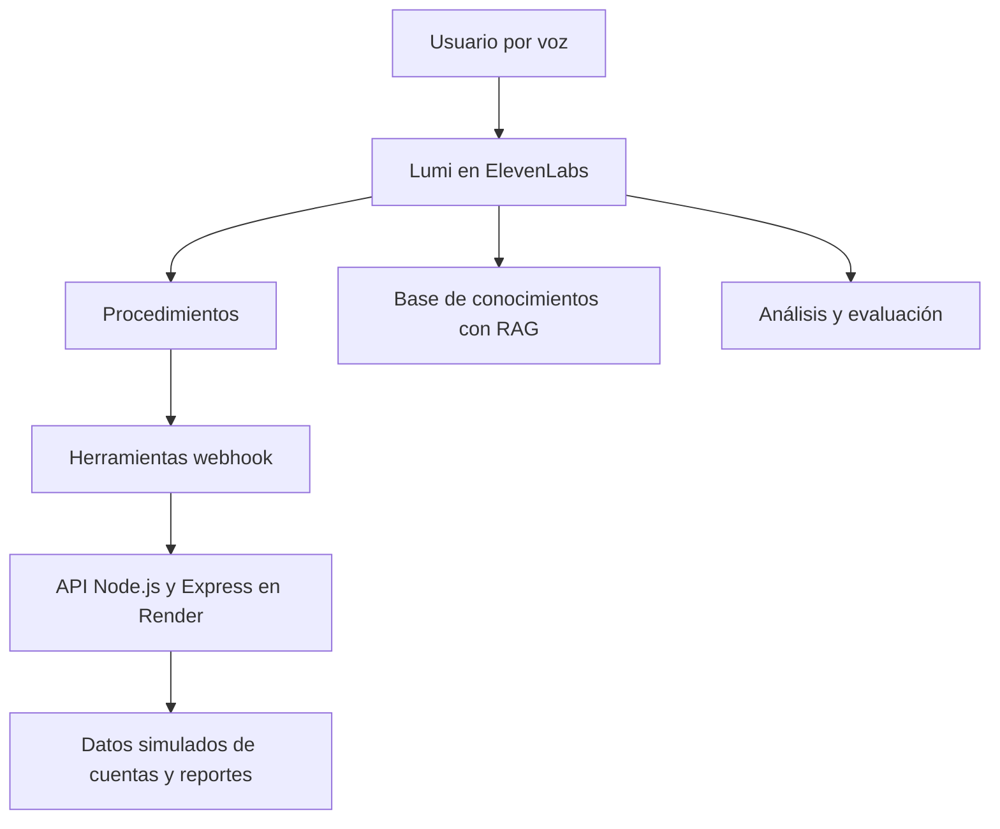

# Lumi — Agente de voz para Ruta Energía

**Prueba técnica · ElevenLabs · Juliana Rocha**

Lumi es un agente de voz para atender consultas de factura, registrar fallas del servicio de energía y responder preguntas frecuentes. Combina instrucciones conversacionales, Procedimientos, una Base de conocimientos con RAG y dos herramientas conectadas a una API simulada.

El proyecto utiliza datos de prueba; no consulta cuentas reales ni registra solicitudes en una empresa de energía.

## Enlaces de entrega

| Recurso | Enlace |
|---|---|
| Agente Lumi | https://elevenlabs.io/app/talk-to?agent_id=agent_5301m6fnbn02ennrn1wx6h1krphq&branch_id=agtbrch_1201m6fnbq59fwqbbkwyy4m8cv3x |
| Repositorio GitHub | https://github.com/julianarochakjrs-design/prueba-tecnica-lumi-2nv |
| Video demo en Loom | https://www.loom.com/share/bd0e5b0e9bef4752a545a2eb30815067 |
| Captura de las seis pruebas aprobadas | https://drive.google.com/file/d/1IVgVRFQjHUvP14nK3WZypmBssqlkDhzZ/view?usp=sharing |

## Alcance funcional

| Caso | Comportamiento |
|---|---|
| Consulta de factura | Solicitar y confirmar la cuenta, consultar la API y comunicar los datos disponibles. |
| Reporte de falla | Recopilar cuenta, alcance y descripción de la afectación; registrar el reporte y comunicar radicado y tiempo estimado. |
| Preguntas frecuentes | Consultar información general mediante la Base de conocimientos. |
| Cuenta inexistente | Manejar la respuesta 404 sin inventar datos. |
| Solicitud de atención humana | Reconocer la intención y aplicar las instrucciones de escalamiento configuradas. No se acredita una transferencia real a un contact center en esta prueba. |
| Fuera de alcance | Explicar el alcance de Lumi y orientar la conversación hacia los servicios disponibles. |

## Arquitectura

La configuración entregada mantiene Flujo de trabajo y Procedimientos. El prompt define las reglas generales y los Procedimientos desarrollan los casos específicos. Las herramientas consultan o registran información externa y sus resultados se incorporan a la conversación.

## Componentes y decisiones de diseño

### Prompt principal

Define la identidad de Lumi, el tono colombiano, el tuteo, las respuestas breves para voz, el alcance, las restricciones frente a información inventada y las condiciones de escalamiento.

Se priorizó que los datos de una cuenta, los radicados y los tiempos estimados provinieran de la API. La Base de conocimientos se reservó para información general.

Este README resume el prompt; no constituye una exportación literal de la configuración del agente.

### Procedimientos y Flujo de trabajo

Los Procedimientos organizan la consulta de factura y el reporte de falla. En factura se busca recopilar y confirmar el número antes de consultar. En fallas se recopilan los datos necesarios antes de registrar el caso.

Durante las iteraciones se separó parte de la interacción conversacional de la ejecución estructurada de la herramienta para mejorar la estabilidad. Para el reporte se utilizó un procedimiento de formato libre que permite recopilar los datos de forma conversacional.

Se conservó la coexistencia con el Flujo de trabajo tras obtener ejecuciones exitosas. En pruebas previas se observaron duplicidades potencialmente relacionadas con esta coexistencia, sin confirmar una causa única. Como evolución se propone concentrar progresivamente la lógica en Procedimientos y verificar el resultado con pruebas de regresión.

### Base de conocimientos y RAG

La Base de conocimientos contiene las FAQ de Ruta Energía. RAG recupera contenido relevante para las preguntas generales. Los saldos, estados y demás datos particulares de una cuenta se obtienen mediante herramientas.

### API simulada

La API se construyó con **Node.js y Express** y se desplegó en **Render** para disponer de una URL pública HTTPS accesible desde ElevenLabs.

| Herramienta | Método y ruta | Entrada funcional | Resultado |
|---|---|---|---|
| `consultar_cuenta` | `GET /cuentas/{numero}` | Número de cuenta | Titular, saldo, fecha límite y estado; 404 si no existe. |
| `registrar_falla` | `POST /fallas` | Cuenta, tipo de falla, alcance y descripción | Radicado y tiempo estimado de atención. |

Las entradas de la tabla describen el contenido funcional. Para los nombres exactos de los campos JSON, consultar el código y la configuración de las herramientas.

### Autenticación

Las peticiones incluyen una API key en el header `x-api-key`. En ElevenLabs se almacena como secreto y la API valida la credencial recibida.

No se debe incluir su valor en el prompt, README, capturas, video ni repositorio. La credencial debe configurarse de forma consistente en ambos extremos.

## Recorrido de los casos principales

### Consulta de factura

1. El usuario solicita consultar la factura.
2. Lumi solicita el número de cuenta de seis dígitos y busca confirmarlo.
3. Ejecuta `consultar_cuenta`.
4. Comunica los datos devueltos por la API.
5. Si recibe un 404 o la consulta falla, evita inventar información y comunica la situación.

**Cuenta utilizada en la demostración:** `104528`.

### Reporte de falla

1. El usuario informa una interrupción del servicio.
2. Lumi identifica si afecta al hogar o al sector y recopila la descripción.
3. Solicita y confirma la cuenta.
4. Ejecuta `registrar_falla` con los datos recopilados.
5. Comunica el radicado y el tiempo estimado que devuelve la API.

**Cuenta utilizada en la demostración:** `459903`.

## Análisis de conversaciones

Se configuraron criterios de evaluación y recolección de datos para revisar la validación de cuenta, resolución de la solicitud, uso de información soportada y calidad conversacional.

La recolección contempla información como cuenta, tipo de solicitud, resultado y radicado cuando corresponde. Los resultados deben revisarse junto con la transcripción y las ejecuciones de herramientas; la evaluación automática no sustituye la revisión manual.

## Pruebas y evidencias

### Pruebas automatizadas

Se reportaron **seis pruebas aprobadas en ElevenLabs**, con la siguiente cobertura funcional:

| Escenario | Propósito |
|---|---|
| Confirmación de cuenta | Verificar el paso de validación del número. |
| Consulta de factura | Verificar el recorrido de consulta y la respuesta. |
| Cuenta inexistente / 404 | Verificar el manejo sin datos inventados. |
| Reporte de falla | Verificar registro y comunicación del radicado. |
| Atención humana | Verificar el reconocimiento de la solicitud de escalamiento. |
| Fuera de alcance | Verificar los límites del agente. |

Estos resultados corresponden a la ejecución registrada durante la prueba técnica y no garantizan que todas las futuras conversaciones sigan el mismo comportamiento.

### Pruebas manuales

Se realizaron pruebas en texto y voz para revisar las integraciones y los turnos conversacionales. Las dos ejecuciones finales de voz funcionaron y quedaron grabadas en Loom:

| Conversación | Cuenta | Duración |
|---|---|---|
| Consulta de factura | `104528` | 1 min 15 s |
| Reporte de falla | `459903` | 1 min 1 s |

La entrega debe acompañarse de la captura de las seis pruebas aprobadas y las dos transcripciones con su análisis. Los enlaces se incorporan en la sección inicial cuando estén disponibles.

## Iteraciones y aprendizajes

- Se validaron los endpoints antes de conectar las herramientas de ElevenLabs.
- Se desplegó la API y se configuró autenticación mediante secreto.
- Se ajustaron los Procedimientos y la separación entre conversación y ejecución de herramientas.
- Se probaron casos exitosos, cuenta inexistente, escalamiento y solicitudes fuera de alcance.
- Tras obtener dos llamadas exitosas, se mantuvo la configuración para cerrar la entrega con evidencias de la versión probada.

El aprendizaje principal fue comprender el recorrido completo: datos recopilados por el agente, parámetros enviados a la API, respuesta recibida y forma en que Lumi debe comunicarla sin completar información por su cuenta.

## Limitaciones conocidas

- **Confirmación y turnos:** en algunas pruebas previas Lumi preguntó si la cuenta era correcta y continuó sin esperar la respuesta. Las ejecuciones exitosas finales no eliminan este comportamiento observado.
- **Duplicidad:** se observaron repeticiones en algunas ejecuciones. La combinación de Flujo de trabajo y Procedimientos es una hipótesis por revisar, no una causa demostrada.
- **Disponibilidad de la API:** una consulta previa falló; se consideró un posible arranque en frío del alojamiento, sin confirmarlo mediante diagnóstico. Deben revisarse logs y tiempos antes de atribuirle la causa.
- **Entorno simulado:** no se ha acreditado una integración con sistemas comerciales reales ni una transferencia efectiva a asesores humanos.
- **Persistencia y concurrencia:** no se documentan aquí garantías de conservación de reportes, idempotencia o capacidad de producción. Deben verificarse en el código y ampliarse antes de un uso real.

## Cómo revisar la solución

1. Abrir el agente mediante el enlace de entrega.
2. Solicitar una consulta de factura con la cuenta `104528`.
3. Reportar una falla utilizando la cuenta `459903`.
4. Revisar la ejecución de las herramientas y contrastar la respuesta con la transcripción.
5. Consultar las pruebas automatizadas y el análisis de las dos conversaciones.
6. Revisar el código de la API y las limitaciones documentadas.

Para reproducir la API localmente se requieren Node.js, las dependencias declaradas por el proyecto y la configuración de su credencial. Los comandos de inicio, nombres de variables y versión de Node deben tomarse del `package.json` y del código del repositorio; no se han verificado para la elaboración de este documento.

## Próximos pasos

1. Simplificar la lógica entre Flujo de trabajo y Procedimientos.
2. Asegurar la espera de confirmación del usuario antes de ejecutar una herramienta.
3. Prevenir registros repetidos mediante controles de idempotencia.
4. Fortalecer el manejo de errores, latencia y disponibilidad de la API.
5. Ampliar las pruebas de voz con interrupciones, correcciones y distintos formatos de cuenta.
6. Incorporar persistencia y transferencia real a atención humana si el alcance evoluciona a producción.

## Uso de inteligencia artificial

Utilicé inteligencia artificial como apoyo para construir el código de la API, comprender conceptos técnicos, revisar configuraciones, plantear pruebas y estructurar la documentación.

Mi participación incluyó configurar el agente y sus herramientas, desplegar la API, ejecutar pruebas, identificar comportamientos no esperados y seleccionar la versión entregada. Puedo explicar el propósito de los endpoints, los datos intercambiados, la autenticación y el manejo esperado de errores.

## Nota de documentación

Este README se elaboró a partir del proceso y los resultados descritos durante el desarrollo. No incluye una auditoría independiente del repositorio ni una exportación de ElevenLabs. Los detalles de ejecución local deben contrastarse con el código del repositorio.
